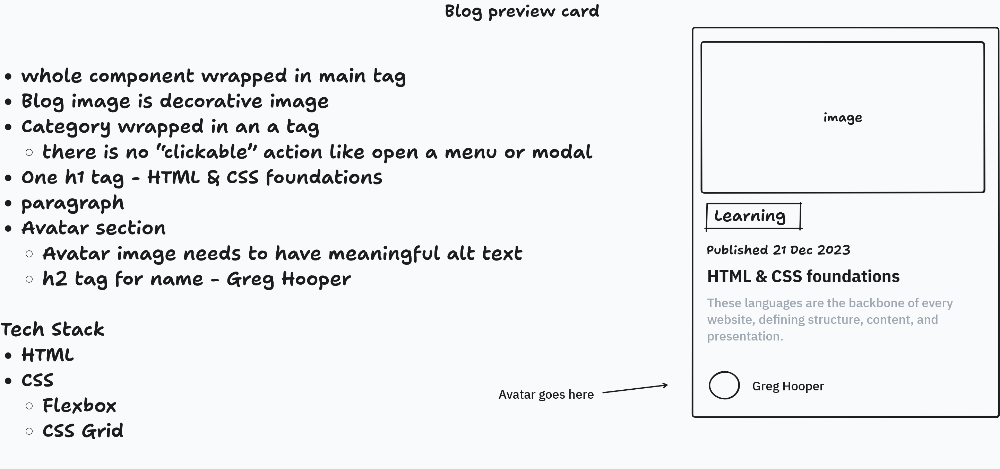

# Frontend Mentor - Blog preview card 

This is a solution to the [Blog preview card challenge on Frontend Mentor](https://www.frontendmentor.io/challenges/blog-preview-card-ckPaj01IcS). Frontend Mentor challenges help you improve your coding skills by building realistic projects. 

## Overview
Users should be able to:

- See hover and focus states for all interactive elements on the page

### Live Demo

- Solution URL: [Frontend Mentor]()
- Live Site URL: [GitHub Pages]()

## Built with

- HTML
- CSS 
  - Flexbox
  - CSS Grid

### What I learned

- Plan project structure using [tldraw](https://www.tldraw.com/) first before jumping into the code. 
  
  

## Video Preview

https://github.com/user-attachments/assets/0da8bda4-b6fe-49d5-b1a0-25d024670d9d

## Author
- Frontend Mentor - [@rebeccadoesweb](https://www.frontendmentor.io/profile/rebeccadoesweb)
- GitHub - [@rebeccadoesweb](https://github.com/rebeccadoesweb)
- LinkedIn - [@rebecca-web-dev](https://www.linkedin.com/in/rebecca-web-dev/)

## Acknowledgments

- Google Font Helper - [Google Fonts Helper](https://gwfh.mranftl.com/fonts) - I used free Google Font Helper to generate the font imports.
- [Coolors Color Contrast Checker](https://coolors.co/contrast-checker) - I used this to check the contrast ratio between colors especifically for the attribution text.
